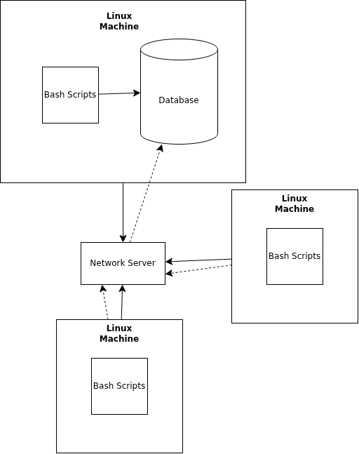

# Introduction

The purpose of this repository is to build and deploy Shell scripts to automatically monitor Linux resource usage in real-time to then create reports for future resource planning projects.

It incorporates [Bash scripts](https://en.wikipedia.org/wiki/Bash_(Unix_shell)), [PostgreSQL](https://www.postgresql.org/), [Docker](https://www.docker.com/), and [Crontab](https://en.wikipedia.org/wiki/Cron). The SQL queries will build PostgreSQL tables to hold the data while the Bash scripts will run standardized templates to run custom commands within a Docker container. Crontab is used to automatically run the scripts.

All of the code within this repository is expected to run on a Rocky Linux 9 x86 64-bit machine. Using other operating systems such as MacOS or Windows is currently not supported and thus may cause issues if it were to run on said environments.

# Quick Start

Start a PSQL instance with Docker

```bash
# Create a PSQL Docker container
./scripts/psql_docker.sh create db_username db_password

# Start a PSQL Docker container
./scripts/psql_docker.sh start

# Stop a PSQL Docker container
./scripts/psql_docker.sh stop
```

Create tables using `ddl.sql`

```bash
# From the root folder of the repository, run the following command:

psql -h localhost -U postgres -d host_agent -f sql/ddl.sql
```

Run hardware specs usage and data

```bash
# Can run the scripts by themselves

# Insert hardware specs data into the DB using host_info.sh
./scripts/host_info.sh psql_host psql_port db_name psql_user psql_password

# Insert hardware usage data into the DB using host_usage.sh
bash scripts/host_usage.sh psql_host psql_port db_name psql_user psql_password
```

Crontab setup

```bash
crontab -e

# Once you're in Crontab, enter this command:
* * * * * bash /home/rocky/jarvis_data_eng_LucasLee/host_usage.sh localhost 5432 host_agent postgres password > /tmp/host_usage.log

# Leave crontab and check if it is inserted:
crontab -l
```

# Implemenation

There will be one centralized database for this project. From this, each Linux machine will run the scripts with Crontab by itself and insert the data into the database. See the architecture image for a visual representation.

## Architecture



## Scripts

`psql_docker.sh`: Run custom commands to create, start, and stop a Docker container

```bash
# Create a PSQL Docker container
./scripts/psql_docker.sh create db_username db_password

# Start a PSQL Docker container
./scripts/psql_docker.sh start

# Stop a PSQL Docker container
./scripts/psql_docker.sh stop
```

`host_info.sh`: Build a script to get the host's machine data

```bash
./scripts/host_info.sh psql_host psql_port db_name psql_user psql_password
```

`host_usage.sh`: Retreive CPU and memory usage data

```bash
bash scripts/host_usage.sh psql_host psql_port db_name psql_user psql_password
```

`crontab`: Automate the data collecting

```bash
crontab -e

# Once you're in Crontab, enter this command:
* * * * * bash /home/rocky/jarvis_data_eng_LucasLee/host_usage.sh localhost 5432 host_agent postgres password > /tmp/host_usage.log
```

## Database Modeling

### `host_info`

| **Column Name** | **Data Type** | **Description** |
|---|---|---|
| `id` | `SERIAL` (auto-incrementing integer), NOT NULL | Automatically build unique identifier for each row |
| `hostname` | `VARCHAR`, NOT NULL | Host machine's name |
| `cpu_number` | `INT2`, NOT NULL | Number of CPUs on the host |
| `cpu_architecture` | `VARCHAR`, NOT NULL | CPU architecture, e.g. `x86_64`, `arm64`, etc. |
| `cpu_model` | `VARCHAR`, NOT NULL | Model name of the CPU, e.g. `Intel(R) Xeon(R) CPU @ 2.30GHz` |
| `cpu_mhz` | `FLOAT8`, NOT NULL | CPU clock speed in MHz |
| `l2_cache` | `INT4`, NOT NULL | Size of the CPU's L2 cache in KB |
| `"timestamp"` | `TIMESTAMP`, NULL | Date and time the record was collected |
| `total_mem` | `INT4`, NULL | Total memory on the host in KB |

### `host_usage`

| **Column Name** | **Data Type** | **Description** |
|---|---|---|
| `"timestamp"` | `TIMESTAMP`, NOT NULL | Date and time the record was collected |
| `host_id` | `SERIAL`, NOT NULL | Foreign key referencing `host_info(id)` to identify which host the usage data belongs to |
| `memory_free` | `INT4`, NOT NULL | Amount of free memory on the host in MB |
| `cpu_idle` | `INT2`, NOT NULL | Percentage of CPU time spent idle |
| `cpu_kernel` | `INT2`, NOT NULL | Percentage of CPU time spent running the kernel |
| `disk_io` | `INT4`, NOT NULL | Number of disk I/O operations currently in progress |
| `disk_available` | `INT4`, NOT NULL | Available disk space on the host in MB |

# Test

It was tested with a variety of custom insert statements to check whether the database would hold the correct information. For example, I would use strings for columns that wanted numbers or insert timestamps that were not in the correct format. The results concluded that the database schema remained intact and did not suffer any data type conflicts.

# Deployment

The repository's source code is hosted on GitHub.

Docker is used to connect ``postgres:9.6-alpine`` and create a container from it.

Crontab is used to run automated scripts.

# Improvements

- Handle hardware updates
- Create functions for scripts because some of the code is repeated
- Build a frontend to more easily view the database
